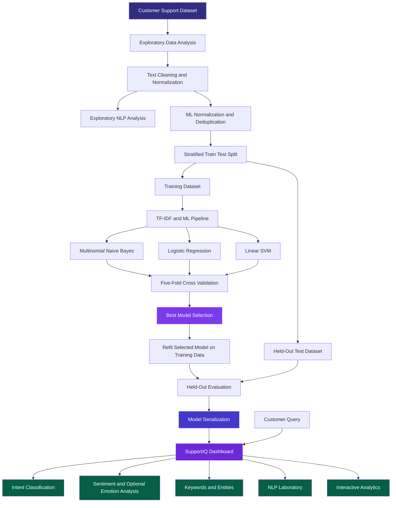

<div align="center">

# ✦ SupportIQ

### Customer Support Intelligence System

**Natural Language Processing · Machine Learning · Interactive Analytics**

An end-to-end AI-powered customer support intelligence platform that transforms unstructured customer conversations into meaningful insights.

<br>


<br>


<br>

[](https://www.linkedin.com/in/dhruv-panchal-a14865258/)

[](https://github.com/dhruv4AlgoForge)

<br>

[Overview](#project-overview) •
[Features](#key-features) •
[Dashboard](#application-dashboard) •
[NLP](#natural-language-processing) •
[Results](#model-performance) •
[Installation](#installation-and-setup)

</div>

---

## Project Overview

SupportIQ is an end-to-end Natural Language Processing and Machine Learning application designed to automate the understanding and classification of customer support conversations.

The system processes unstructured customer messages, identifies customer intentions, predicts support categories, analyzes sentiment, extracts important keywords and structured entities, and provides detailed linguistic insights.

The project combines classical NLP techniques, statistical text modeling, semantic embeddings, supervised Machine Learning, and pretrained Transformer-based emotion analysis.

An interactive Streamlit dashboard with a custom purple glassmorphism interface provides real-time model inference and visual analytics.

### Problem Statement

Customer support departments receive large volumes of unstructured messages related to accounts, payments, orders, refunds, shipping, invoices, and other services.

Manually identifying and categorizing customer requests can be time-consuming and inefficient.

SupportIQ demonstrates how NLP and Machine Learning can automate customer query understanding and provide structured information that could support intelligent customer service workflows.

---

## Key Features

| Module | Capabilities |
|:---|:---|
| **Query Intelligence** | Customer intent prediction, category classification and confidence analysis |
| **Sentiment Analysis** | Positive, negative and neutral sentiment classification using VADER |
| **Emotion Intelligence** | Optional pretrained DistilRoBERTa emotion classification |
| **Keyword Extraction** | TF-IDF-based keyword and key phrase extraction |
| **Entity Recognition** | General-purpose NER and regex-based customer identifiers |
| **NLP Laboratory** | Tokenization, stemming, lemmatization, POS tagging and syntactic analysis |
| **Semantic Analysis** | Notebook-based Word2Vec embeddings and cosine similarity experiments |
| **Topic Modeling** | Notebook-based Latent Dirichlet Allocation |
| **Text Summarization** | TF-IDF-based extractive sentence summarization |
| **Dataset Analytics** | Interactive category distributions, intent distributions and record filtering |
| **Model Evaluation** | Classification metrics, prediction outcomes and evaluation methodology |

---

## Performance at a Glance

<div align="center">

<table>
<tr>
<td align="center" width="25%">
<h2>26,872</h2>
Dataset Records
</td>
<td align="center" width="25%">
<h2>99.28%</h2>
Test Accuracy
</td>
<td align="center" width="25%">
<h2>27</h2>
Customer Intents
</td>
<td align="center" width="25%">
<h2>11</h2>
Support Categories
</td>
</tr>
<tr>
<td align="center">
<h2>99.29%</h2>
Macro Precision
</td>
<td align="center">
<h2>99.12%</h2>
Macro Recall
</td>
<td align="center">
<h2>99.20%</h2>
Macro F1-Score
</td>
<td align="center">
<h2>99.77%</h2>
Category Accuracy
</td>
</tr>
</table>

</div>

> Evaluation was performed on a held-out subset of a synthetic customer support dataset. These results do not guarantee equivalent performance on real-world customer conversations.

---

## Application Dashboard

SupportIQ features a modern purple glassmorphism dashboard built using Streamlit, Plotly, HTML and CSS.

### 01 — Query Intelligence

<div align="center">


</div>

The primary workspace provides customer query analysis, dataset statistics, intent prediction and real-time linguistic insights.

<details>
<summary><b>View Customer Query Input and Quick Examples</b></summary>

<br>

<table>
<tr>
<td width="50%">

</td>
<td width="50%">

</td>
</tr>
<tr>
<td align="center">Predefined Customer Queries</td>
<td align="center">Custom Query Analysis</td>
</tr>
</table>

</details>

### 02 — Intent Prediction and Sentiment Intelligence

<div align="center">


</div>

The prediction dashboard displays:

- Predicted customer support category
- Predicted customer intent
- Model confidence gauge
- Top three alternative intent probabilities
- VADER sentiment classification
- Sentiment score distribution
- Low-confidence prediction warnings

<details>
<summary><b>View Keyword Extraction and Emotion Intelligence</b></summary>

<br>


The optional Transformer module includes graceful error handling when the required dependencies are unavailable.

</details>

### 03 — NLP Analysis Laboratory

<div align="center">


</div>

An interactive laboratory for exploring lexical, grammatical and statistical transformations of natural language.

<details>
<summary><b>View Text Preprocessing and Linguistic Analysis</b></summary>

<br>


<p align="center"><b>Text Normalization, Tokenization and Preprocessing</b></p>

<br>


<p align="center"><b>Part-of-Speech Tagging, Named Entities and Noun Phrases</b></p>

</details>

### 04 — Dataset Insights

<div align="center">


</div>

Interactive exploratory data analysis provides insights into customer support category distributions and dataset characteristics.

<details>
<summary><b>View Customer Intent Distribution</b></summary>

<br>


</details>

### 05 — Model Performance

<div align="center">


</div>

A dedicated evaluation workspace visualizes held-out classification metrics, category accuracy, correct predictions and classification errors.

<details>
<summary><b>View Training Distribution and Evaluation Methodology</b></summary>

<br>


</details>

---

## System Architecture



---

## Technology Stack

<div align="center">

### Core Development


</div>

| Domain | Technologies |
|:---|:---|
| Programming | Python |
| Data Analysis | Pandas, NumPy |
| Visualization | Matplotlib, Seaborn, Plotly |
| Natural Language Processing | NLTK, spaCy |
| Semantic Embeddings | Gensim, Word2Vec |
| Machine Learning | Scikit-learn |
| Transformer Models | Hugging Face Transformers, PyTorch |
| Application Development | Streamlit |
| Interface Design | HTML, CSS, Glassmorphism |
| Model Persistence | Joblib |
| Development Environment | VS Code, Jupyter Notebook |
| Version Control | Git, GitHub |

---

## Dataset Information

The project uses a Bitext customer support dataset containing synthetic customer queries, support categories, customer intents and response templates.

### Dataset Summary

| Attribute | Value |
|:---|---:|
| Total Records | 26,872 |
| Total Columns | 5 |
| Unique Raw Queries | 24,635 |
| Repeated Raw Queries | 2,237 |
| Missing Values | 0 |
| Duplicate Complete Rows | 0 |
| Customer Support Categories | 11 |
| Customer Intents | 27 |

### Dataset Schema

| Column | Description |
|:---|:---|
| flags | Customer query variation indicators |
| instruction | Unstructured customer support message |
| category | High-level customer support category |
| intent | Specific customer intention |
| response | Corresponding customer support response |

### Category Distribution

| Category | Records |
|:---|---:|
| ACCOUNT | 5,986 |
| ORDER | 3,988 |
| REFUND | 2,992 |
| INVOICE | 1,999 |
| CONTACT | 1,999 |
| PAYMENT | 1,998 |
| FEEDBACK | 1,997 |
| DELIVERY | 1,994 |
| SHIPPING | 1,970 |
| SUBSCRIPTION | 999 |
| CANCEL | 950 |
| **Total** | **26,872** |

<details>
<summary><b>View All 27 Supported Customer Intents</b></summary>

<br>

| Category | Supported Intents |
|:---|:---|
| ACCOUNT | create_account, delete_account, edit_account, recover_password, registration_problems, switch_account |
| ORDER | cancel_order, change_order, place_order, track_order |
| REFUND | get_refund, track_refund, check_refund_policy |
| PAYMENT | payment_issue, check_payment_methods |
| INVOICE | get_invoice, check_invoice |
| DELIVERY | delivery_options, delivery_period |
| SHIPPING | change_shipping_address, set_up_shipping_address |
| CONTACT | contact_customer_service, contact_human_agent |
| FEEDBACK | complaint, review |
| SUBSCRIPTION | newsletter_subscription |
| CANCEL | check_cancellation_fee |

</details>

---

## Exploratory Data Analysis

Exploratory data analysis was conducted to understand the structure, distribution and linguistic characteristics of customer support conversations.

- Dataset structure and data quality analysis
- Missing values and duplicate analysis
- Category and intent distribution
- Customer query word count and character count
- Vocabulary and lexical diversity analysis
- Word frequency distribution
- Unigram, bigram and trigram analysis
- Word cloud visualization
- Category-wise customer message analysis

### Vocabulary Statistics

| Metric | Result |
|:---|---:|
| Regex-Based Tokens | 234,612 |
| Unique Vocabulary | 2,841 |
| Type-Token Ratio | 0.0121 |
| Common Query Length | 6–11 words |
| NLTK Tokens | 236,448 |
| Tokens After Stopword Removal | 129,261 |
| Removed Tokens | 107,187 |
| Stopword Reduction | 45.33% |

---

## Natural Language Processing

The project covers 23 NLP techniques and analytical components across text preprocessing, linguistic analysis, feature extraction, semantic modeling and classification.

| No. | NLP Technique | Implementation |
|:---:|:---|:---|
| 01 | Text Cleaning and Normalization | Unicode, regex, contractions and whitespace |
| 02 | Word Tokenization | NLTK |
| 03 | Sentence Tokenization | NLTK |
| 04 | Stopword Removal | Negation-aware filtering |
| 05 | Stemming | Porter Stemmer |
| 06 | Lemmatization | POS-aware WordNet Lemmatizer |
| 07 | Negation Handling | Fixed-window negation processing |
| 08 | Part-of-Speech Tagging | NLTK POS Tagger |
| 09 | Named Entity Recognition | spaCy |
| 10 | Domain-Specific Entity Extraction | Regular expressions |
| 11 | Dependency Parsing | spaCy |
| 12 | Noun Phrase Extraction | spaCy noun chunks |
| 13 | One-Hot Encoding | Numerical text representation |
| 14 | Bag of Words | CountVectorizer |
| 15 | TF-IDF | TfidfVectorizer |
| 16 | N-Gram Analysis | Unigrams, bigrams and trigrams |
| 17 | Keyword Extraction | TF-IDF phrase ranking |
| 18 | Word2Vec | CBOW and Skip-Gram |
| 19 | Cosine Similarity | Related query retrieval |
| 20 | Sentiment Analysis | VADER |
| 21 | Emotion Classification | DistilRoBERTa |
| 22 | Topic Modeling | Gensim LDA |
| 23 | Extractive Summarization | TF-IDF sentence scoring |

<details>
<summary><b>Text Preprocessing — Implementation Details</b></summary>

### Text Normalization

- Unicode normalization
- HTML entity decoding
- Lowercase conversion
- HTML tag removal
- URL removal
- Contraction expansion
- Punctuation removal
- Whitespace normalization

Example:

    Original:
    I CAN'T access my account!!!

    Normalized:
    i can not access my account

### Tokenization

    ['i', 'can', 'not', 'access', 'my', 'account']

### Stopword Removal

Important negation terms are preserved, including:

    not, no, never, nor, cannot, without, neither

### Stemming

    processing  -> process
    recovering  -> recov

### Lemmatization

    orders  -> order
    running -> run

### Negation Handling

    not access account
    not NOT_access NOT_account

</details>

<details>
<summary><b>Linguistic Analysis — POS, NER and Dependency Parsing</b></summary>

<br>

| Metric | Result |
|:---|---:|
| Distinct POS Tags | 36 |
| POS-Tagged Tokens | 272,214 |
| Queries with General-Purpose Entities | 1,546 |
| General-Purpose NER Coverage | 5.75% |
| Queries with Domain-Specific Entities | 7,694 |
| Domain Entity Coverage | 28.63% |
| Extracted Noun Chunks | 76,398 |
| Distinct Dependency Relations | 39 |

Domain-specific entity extraction supports:

- Order identifiers
- Invoice identifiers
- Account identifiers
- Tracking identifiers
- Email addresses
- Monetary amounts
- Template placeholders

Entity detection coverage should not be interpreted as extraction accuracy.

</details>

<details>
<summary><b>Text Representation and Keyword Extraction</b></summary>

<br>

| Parameter | Result |
|:---|---:|
| Bag of Words Matrix | 26,872 × 2,681 |
| Exploratory TF-IDF Matrix | 26,872 × 2,681 |
| Matrix Sparsity | Approximately 99.83% |
| Keyword Vectorizer Features | 4,824 |
| Keyword N-Gram Range | (1, 2) |
| Maximum Displayed Keywords | 5 |

TF-IDF is used for:

- Machine Learning classification
- Keyword extraction
- Customer query similarity
- Extractive summarization

</details>

<details>
<summary><b>Word2Vec and Semantic Similarity</b></summary>

### Word2Vec Configuration

| Parameter | Value |
|:---|---:|
| Architectures | CBOW and Skip-Gram |
| Vector Size | 100 |
| Context Window | 5 |
| Minimum Word Count | 2 |
| Training Epochs | 15 |
| Vocabulary Size | 1,027 |
| Random State | 42 |

### Word Similarity Results

| Word Pair | CBOW | Skip-Gram |
|:---|---:|---:|
| Refund — Reimbursement | 0.8761 | 0.8377 |
| Order — Purchase | 0.8758 | 0.8528 |
| Delivery — Shipping | 0.8785 | 0.8011 |

### Cosine Similarity Retrieval

Example customer query:

    I want to cancel my order.

Retrieved intent:

    cancel_order

Top similarity score:

    0.8763

Similarity scores measure textual relationships, not classification accuracy.

</details>

<details>
<summary><b>Sentiment Analysis — VADER</b></summary>

<br>

| Sentiment | Records | Distribution |
|:---|---:|---:|
| Neutral | 14,429 | 53.70% |
| Positive | 8,310 | 30.92% |
| Negative | 4,133 | 15.38% |

Classification thresholds:

- Positive: compound score >= 0.05
- Negative: compound score <= -0.05
- Neutral: compound score strictly between -0.05 and 0.05

These are predicted sentiment distributions rather than ground-truth annotations.

</details>

<details>
<summary><b>Transformer-Based Emotion Analysis</b></summary>

### Pretrained Model

    j-hartmann/emotion-english-distilroberta-base

Emotion inference was explored on a random sample of 1,000 customer queries.

| Emotion | Predicted Records |
|:---|---:|
| Neutral | 577 |
| Sadness | 272 |
| Anger | 75 |
| Surprise | 37 |
| Fear | 18 |
| Joy | 16 |
| Disgust | 5 |

Average model confidence: 70.42%.

This represents prediction confidence rather than measured classification accuracy.

The dashboard includes optional Transformer inference with dependency error handling.

</details>

<details>
<summary><b>Topic Modeling — Latent Dirichlet Allocation</b></summary>

<br>

| Parameter | Value |
|:---|---:|
| Number of Topics | 5 |
| Dictionary Size | 432 |
| Coherence Score | 0.3957 |
| Assigned Records | 26,832 |
| Unassigned Records | 40 |

Manually interpreted topics:

| Topic | Theme | Records |
|:---:|:---|---:|
| 1 | Order and Product Management | 5,900 |
| 2 | Refund and Payment Services | 4,829 |
| 3 | Account Management | 4,689 |
| 4 | Shipping and Customer Feedback | 5,409 |
| 5 | Delivery, Billing and Technical Issues | 6,005 |

</details>

<details>
<summary><b>Extractive Text Summarization</b></summary>

The summarization pipeline consists of:

1. Sentence tokenization.
2. TF-IDF vectorization.
3. Sentence importance scoring.
4. Selection of top-ranked sentences.
5. Reconstruction in original sentence order.

Average word reduction across five exploratory examples: 52.71%.

Word reduction measures text compression, not summarization quality.

</details>

---

## Machine Learning Pipeline

### Dataset Preparation

<div align="center">

| Original Dataset | Processed Dataset | Training Set | Testing Set |
|:---:|:---:|:---:|:---:|
| 26,872 | 23,472 | 18,777 | 4,695 |

</div>

Machine Learning preprocessing includes:

- Placeholder normalization
- Numerical normalization
- Preservation of useful contextual words
- Removal of empty normalized queries
- Conflicting label analysis
- Removal of 3,400 duplicate normalized queries
- Stratified 80:20 train-test split
- Random state of 42
- Zero exact normalized query overlap between training and testing sets

### Feature Engineering

| TF-IDF Parameter | Configuration |
|:---|:---|
| N-Gram Range | (1, 2) |
| Minimum Document Frequency | 2 |
| Maximum Features | 20,000 |
| Sublinear Term Frequency | True |

TF-IDF vectorization is included within the classification pipeline to avoid fitting feature statistics on held-out validation data.

### Evaluated Algorithms

<table>
<tr>
<td width="33%" align="center">
<h3>Naive Bayes</h3>
MultinomialNB
<br><br>
alpha = 0.5
</td>
<td width="33%" align="center">
<h3>Logistic Regression</h3>
Selected Model
<br><br>
C = 5
<br>
max_iter = 1000
</td>
<td width="33%" align="center">
<h3>Support Vector Machine</h3>
LinearSVC
<br><br>
C = 1
<br>
max_iter = 5000
</td>
</tr>
</table>

---

## Model Performance

### Five-Fold Cross-Validation Results

| Model | Accuracy | Precision | Recall | Macro F1 |
|:---|---:|---:|---:|---:|
| **Logistic Regression** | **99.23%** | **99.20%** | **99.07%** | **99.12%** |
| Linear SVM | 99.23% | 99.19% | 99.06% | 99.12% |
| Multinomial Naive Bayes | 98.81% | 98.82% | 98.56% | 98.66% |

Logistic Regression was selected based on its unrounded cross-validation macro F1-score and provides probability estimates for the dashboard.

### Final Held-Out Test Results

<div align="center">

| Metric | Result |
|:---|---:|
| **Accuracy** | **99.28%** |
| Macro Precision | 99.29% |
| Macro Recall | 99.12% |
| Macro F1-Score | 99.20% |
| Category Accuracy | 99.77% |
| Correct Predictions | 4,661 |
| Incorrect Predictions | 34 |
| Total Testing Records | 4,695 |
| Error Rate | 0.72% |

</div>

### Sample Customer Predictions

| Customer Message | Predicted Intent | Confidence |
|:---|:---|---:|
| I forgot my account password. | recover_password | 92.00% |
| I want my money back. | get_refund | 86.49% |
| Please cancel my order immediately. | cancel_order | 48.43% |
| How can I speak with a human agent? | contact_human_agent | 99.50% |
| I need to change my shipping address. | change_shipping_address | 98.17% |

### Confidence Interpretation

| Confidence | Interpretation |
|:---|:---|
| >= 70% | High confidence |
| 40% to below 70% | Moderate confidence |
| Below 40% | Low confidence — review recommended |

These are manually selected demonstration thresholds rather than calibrated probability thresholds.

<details>
<summary><b>View Misclassification Analysis</b></summary>

<br>

| Actual Intent | Predicted Intent |
|:---|:---|
| cancel_order | change_order |
| contact_customer_service | contact_human_agent |
| registration_problems | payment_issue |
| get_invoice | check_invoice |

The errors highlight challenges in distinguishing between semantically similar and ambiguous customer intentions.

Detailed confusion matrix analysis is available in the Jupyter Notebook.

</details>

---

## Project Structure

```text
Customer_Support_Intelligence_NLP/
│
├── .streamlit/
│   └── config.toml
│
├── data/
│   └── customer_support.csv
│
├── models/
│   ├── intent_classifier.pkl
│   ├── intent_category_map.pkl
│   ├── keyword_vectorizer.pkl
│   └── model_metadata.pkl
│
├── notebooks/
│   └── customer_support_nlp.ipynb
│
├── src/
│   ├── __init__.py
│   └── preprocessing.py
│
├── images/
│   └── 12 Dashboard Screenshots
│
├── app.py
├── requirements.txt
├── .gitignore
└── README.md
```

### Saved Model Artifacts

| File | Description |
|:---|:---|
| intent_classifier.pkl | Trained TF-IDF and Logistic Regression pipeline |
| intent_category_map.pkl | Customer intent-to-category mapping |
| keyword_vectorizer.pkl | Fitted keyword extraction vectorizer |
| model_metadata.pkl | Dataset statistics and evaluation results |

Saved model artifacts enable inference without retraining.

---

## Installation and Setup

### 1. Clone the Repository

```bash
git clone https://github.com/dhruv4AlgoForge/Customer_Support_Intelligence_NLP.git

cd Customer_Support_Intelligence_NLP
```

### 2. Create a Virtual Environment

```bash
python -m venv venv
```

### 3. Activate the Environment

**Windows PowerShell**

```powershell
.\venv\Scripts\Activate.ps1
```

**Linux / macOS**

```bash
source venv/bin/activate
```

### 4. Install Dependencies

```bash
python -m pip install -r requirements.txt
```

The classification models were serialized using Scikit-learn 1.8.0. The same version is recommended for compatibility.

### 5. Download NLTK Resources

```bash
python -m nltk.downloader punkt punkt_tab stopwords wordnet omw-1.4 averaged_perceptron_tagger_eng vader_lexicon
```

### 6. Download spaCy Language Model

```bash
python -m spacy download en_core_web_sm
```

### 7. Launch SupportIQ

```bash
python -m streamlit run app.py
```

Open your browser:

```text
http://localhost:8501
```

### 8. Explore the Jupyter Notebook

```bash
python -m jupyter notebook
```

Open:

```text
notebooks/customer_support_nlp.ipynb
```

The notebook contains the exploratory NLP experiments, statistical analysis, feature engineering, Machine Learning training and evaluation.

---

## Application Modules

### Query Intelligence

- Custom customer query input
- Predefined customer support examples
- Real-time intent classification
- Customer category prediction
- Prediction confidence gauge
- Top three predicted intents
- Confidence-based warnings
- VADER sentiment classification
- Sentiment distribution visualization
- TF-IDF keyword extraction
- Optional Transformer emotion classification
- Domain-specific entity extraction

### NLP Analysis Laboratory

- Text normalization
- Word tokenization
- Sentence tokenization
- Stopword removal
- Stemming
- Lemmatization
- Negation handling
- Part-of-speech tagging
- Named entity recognition
- Domain-specific entity extraction
- Noun phrase extraction
- Dependency parsing
- Dependency tree visualization
- Keyword extraction
- Extractive text summarization

### Dataset Insights

- Dataset overview
- Unique customer query analysis
- Customer category distribution
- Customer intent distribution
- Interactive category filters
- Customer query search
- Dataset preview

### Model Performance

- Held-out test accuracy
- Macro precision
- Macro recall
- Macro F1-score
- Category accuracy
- Correct and incorrect prediction counts
- Model evaluation charts
- Training and testing distribution
- Evaluation methodology

Additional experiments including Word2Vec, cosine similarity retrieval, Bag of Words, One-Hot Encoding, LDA topic modeling, and confusion matrix analysis are available in the Jupyter Notebook.

---

## Engineering Highlights

| Challenge | Implemented Approach |
|:---|:---|
| Duplicate customer queries | Normalized text deduplication |
| High-dimensional sparse features | TF-IDF vectorization |
| Negative context preservation | Negation-aware preprocessing |
| Ambiguous customer intent | Top-three probability predictions |
| Structured identifier extraction | Regex-based domain entities |
| Limited general-purpose NER | Customer-specific extraction patterns |
| Model selection | Stratified five-fold cross-validation |
| Feature leakage prevention | Pipeline-based feature fitting |
| Repeated model initialization | Streamlit resource caching |
| Optional dependency failures | Exception handling and graceful fallback |
| Interactive model interpretation | Plotly charts and confidence visualization |

---

## User Interface

The SupportIQ application uses a custom purple glassmorphism-inspired interface.

Design features include:

- Dark purple gradient backgrounds
- Glass-effect metric cards
- Responsive content layout
- Sidebar navigation
- Interactive Plotly charts
- Gradient action buttons
- Keyword pills
- Confidence gauges
- Sentiment donut charts
- Dataset search and filtering
- LinkedIn and GitHub integration

The interface was developed using Streamlit with custom HTML and CSS styling.

---

## Limitations

- The dataset contains synthetic customer support conversations.
- High held-out accuracy may not generalize to real-world customer queries.
- Similar query templates may remain across training and testing data.
- The classifier is restricted to 27 supported intents.
- Prediction probabilities are not calibrated.
- Ambiguous, misspelled and out-of-domain requests may produce incorrect predictions.
- Sentiment and emotion models were not evaluated against ground-truth annotations.
- The optional Transformer module requires additional dependencies and pretrained model access.
- The captured dashboard includes a missing Transformer dependency warning; emotion inference was explored separately in the notebook.
- Word2Vec, LDA topic modeling, cosine similarity and confusion matrix analysis remain notebook-based experiments.
- Cloud deployment and independent reproduction in a fresh environment have not yet been verified.

---

## Future Roadmap

- [ ] Real-world customer support dataset integration
- [ ] Retrieval-Augmented Generation (RAG)
- [ ] Automated customer support chatbot
- [ ] Intelligent ticket routing
- [ ] Multilingual customer intent classification
- [ ] Transformer fine-tuning
- [ ] Out-of-domain detection
- [ ] Probability calibration
- [ ] FastAPI REST API integration
- [ ] Docker containerization
- [ ] AWS cloud deployment
- [ ] Continuous model monitoring

---

## Dataset and Model Credits

### Dataset

**Bitext Customer Support Dataset**

Publisher: Bitext

[Bitext on Hugging Face](https://huggingface.co/datasets/bitext)

Refer to the original dataset documentation and applicable license for usage and redistribution conditions.

### Pretrained Emotion Model

**DistilRoBERTa Emotion Classification**

Model:

    j-hartmann/emotion-english-distilroberta-base

[View Pretrained Emotion Model](https://huggingface.co/j-hartmann/emotion-english-distilroberta-base)

---

## Author

<div align="center">


### Dhruv Panchal

**Master of Computer Applications (MCA)**

AI & ML Enthusiast | Natural Language Processing | Python Developer

Passionate about building intelligent applications, exploring Machine Learning algorithms and transforming data into meaningful solutions.

<br>

[](https://www.linkedin.com/in/dhruv-panchal-a14865258/)

[](https://github.com/dhruv4AlgoForge)

[](https://intellisyslabs.online/)

</div>

---

## Acknowledgements

- Bitext — Customer Support Dataset
- Scikit-learn — Machine Learning Framework
- NLTK — Natural Language Processing
- spaCy — Linguistic Analysis
- Gensim — Semantic Embeddings and Topic Modeling
- Hugging Face — Transformer Models
- Streamlit — Application Development
- Plotly — Interactive Data Visualization

---

<div align="center">

### ✦ SupportIQ

**Transforming Customer Conversations into Meaningful Intelligence**

[](https://github.com/dhruv4AlgoForge/Customer_Support_Intelligence_NLP)

If you found this project useful, consider giving the repository a star.

<br>

Developed by **Dhruv Panchal**

[LinkedIn](https://www.linkedin.com/in/dhruv-panchal-a14865258/) |
[GitHub](https://github.com/dhruv4AlgoForge) |
[Portfolio](https://intellisyslabs.online/)

<br>

[Back to Top](#-supportiq)

</div>
